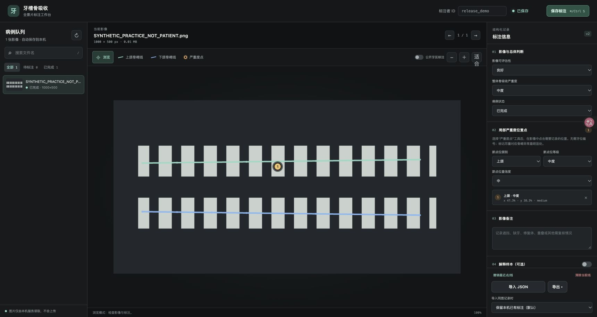

# MambaVision-T · 牙槽骨吸收影像标注工作台

本项目是**单机运行、浏览器访问、无需云端账户**的全景片人工标注工具。每次编辑自动保存到运行机器的 SQLite 数据库，并同步当前病例的独立 JSON 文件；可额外导出 JSON、JSONL、CSV 和用于后续解释模型的数据证据 JSONL。项目不包含影像、患者数据或训练权重。

> 此仓库当前发布的是**标注工具**，不是 NVIDIA MambaVision 官方实现，也不包含 Mamba/VLM 训练程序或预训练权重。

> 研究用途，不是自动出具临床报告的软件。本项目的人工影像标注由经过统一培训的口腔医学生完成，可以作为研究中的影像诊断依据、模型监督标签和结构化证据；正式临床决策仍需由执业口腔/牙周医生结合完整病史和检查确认。

## 功能

- 从指定本地目录递归读取 JPG / JPEG / PNG / WEBP / GIF / BMP / TIFF 影像；支持刷新队列。
- 在原始像素坐标对应的画布上绘制上颌、下颌牙槽嵴折线，并添加局部严重程度位置点。
- 记录筛选后的影像状态、自动生成的整体等级、自动完成状态、标注者 ID、备注和可选的解释样本。
- SQLite 自动保存及修订历史，并自动写入逐病例 JSON 最新版；每个标注者使用自己的数据库/导出包。
- 结构化证据预览；可选只读叠加兼容的 COCO polygon。
- 完整 JSON 导入；JSON / JSONL / 汇总 CSV / evidence-JSONL 导出。CSV 是质控汇总，不包含完整几何，不能代替完整 JSON 备份。
- 多标注者导出汇总：保留每位标注者的原始标注，生成需要人工仲裁的病例清单，不自动平均骨嵴线。
- 默认只绑定 `127.0.0.1`，不会把影像上传到其他服务；前端不依赖 CDN。

## 界面预览

下面仅使用程序生成的合成练习图，不含任何患者影像；线与点只用于演示操作，不代表解剖标注或诊断。



## 培训示例与标注目标

下面两张示例用于说明口腔医学生标注的诊断证据逻辑，**不随 GitHub 仓库发布真实影像**：

| 示例 | 影像情况 | 标注重点 |
| --- | --- | --- |
| 示例 A：正常/未见明显吸收 | 影像已经筛选为可评估，牙槽嵴整体连续，未见明确的局部骨吸收表现 | 绘制可见的上、下颌牙槽嵴线；没有吸收点时系统自动生成 `none`（未见明显吸收）并标记完成 |
| 示例 B：牙槽骨吸收 | 可见牙槽嵴下降、局部不规则或多个区域的骨支持减少 | 分段绘制可见的上、下颌牙槽嵴线；在异常最明显的位置添加严重度点，选择颌别、等级和置信度；病例级选择项目 SOP 对应的等级 |

本次培训截图中：

- **黄色虚线轮廓**是数据集提供的公开牙区辅助 polygon，只用于定位牙区和理解原始标签，不是人工牙槽嵴线，也不需要沿黄色轮廓描画。
- **绿色线**表示人工绘制的上颌牙槽嵴线，**蓝色线**表示人工绘制的下颌牙槽嵴线。
- **带编号的圆点**表示局部严重度位置证据；只有确实需要记录异常的位置才添加，不要为了“每颗牙都有标签”而机械地满屏加点。
- 如果某一段骨嵴被重叠、缺牙、修复体或伪影遮挡，应结束当前线段并在下一个可见区域重新起笔，不要用直线猜测连接。

### 标注证据的使用边界

本项目把受训口腔医学生的全景片标注视为**研究级影像诊断依据**：它可以用于病例分层、模型训练、模型验证和 VLM 的证据输入，不是随意点击产生的普通图像标签。为使这些标注能够稳定支持研究结论，建议采用以下质量流程：

1. 所有标注者先完成统一培训和共同试标，理解正常图、骨吸收图、可疑图和不可评估图的区别。
2. 对正式数据保留 `annotator_id`、影像质量、位置点置信度、病例状态和备注；不要只保存一个最终类别。
3. 至少抽取一部分影像由两名口腔医学生独立标注，保留双方原始版本，不要直接覆盖。
4. 对等级、骨嵴线或位置点存在分歧的病例，由口腔/牙周专业人员进行复核或仲裁，并保留 `needs_review` / `uncertain` 信息。
5. 训练集可以使用学生标注作为监督证据；验证集和最终报告集应优先使用复核/仲裁后的版本，并单独报告学生间一致性与专家一致性。

因此，本文档中的“诊断依据”指**基于全景片的研究影像证据**，不是未经复核即可替代医生的临床诊断结论。

### 正常示例 A 的操作

1. 先确认影像质量是否足以评估骨嵴；质量不足时选择“有限”或“不可评估”，不要直接标成正常。
2. 选择“上颌骨嵴线”和“下颌骨嵴线”，沿可见骨嵴边缘分别绘制。正常不代表不需要画线，正常样本同样需要结构化位置监督。
3. 如果没有明确异常区域，不添加严重度点；不要把公开牙区 polygon 当成严重度点。完成骨嵴线后，系统会将“无吸收点”解释为正常/`none`。
4. 整体骨吸收严重度不能手动选择；系统根据已添加严重度点自动生成，取最高明确等级。
5. 如存在局部可疑但不能确定的区域，应添加 `uncertain` 点；不能为了保持类别平衡而强行标为 `none`。

### 吸收示例 B 的操作

1. 先分别绘制上、下颌骨嵴线；允许一条颌骨有多个独立线段。
2. 在实际观察到骨嵴明显下降、局部不规则或骨支持减少的位置添加严重度点。
3. 每个点必须选择：颌别、严重度和置信度；严重度点表达的是局部影像证据，不自动等于牙位诊断。
4. 对同一连续异常区域，通常在最有代表性的部位放置点即可；只有项目 SOP 明确要求逐牙/逐位点标注时，才扩展到每个位置。
5. 病例级等级应综合整张片的可见范围填写；如果上、下颌或关键区域不可评估，优先使用“不确定/不可评估”并在备注说明。

### 建议的工作标签含义

工具中的 `none / mild / moderate / severe` 是本项目的**影像工作标签**，不是自动推导出的牙周临床分期，也不是未经专家确认的 RBL 百分比：

- `none`：在可评估区域未见明确影像学骨吸收表现；完成骨嵴线且没有吸收点时自动生成。
- `mild`：可见轻微或局限的骨嵴下降/不规则，程度较轻，或接近判定边界。
- `moderate`：可见清楚的局部或多区域骨嵴下降，超过轻微改变，但尚不能按项目标准归入重度。
- `severe`：可见明显、广泛或深度较大的骨支持减少；必须符合项目负责人确认的重度标准。
- `uncertain`：有可疑异常，但影像质量、重叠或结构可见性不足以可靠分级。
- `ungradable`：关键区域无法评估，不能给出有效等级。

在项目正式开标前，口腔/牙周专业负责人需要把上述工作标签进一步固化为内部 SOP，并用一批共同试标图统一边界。口腔医学生按该 SOP 完成初标，不要求标注者自行制定新的阈值。系统不会因为没有点而保留“未判定”：只要已经绘制骨嵴线且没有严重度点，就自动归为 `none`。

## 快速开始

需要 Python 3.9+（核心服务只用 Python 标准库；可选安装 Pillow 用于更准确读取 TIFF 等图像尺寸）。

1. 下载仓库 ZIP 并解压，或运行：

   ```bash
   git clone https://github.com/goodbetterbest1/MambaVision-T.git
   cd MambaVision-T
   ```

   然后按下方 [原始标注图片在哪里下载](#原始标注图片在哪里下载) 获取获授权的图片并运行本地安全解压命令；也可复制负责人已分发的图片到 `data/images/`，子文件夹结构必须在所有标注者间一致。
2. 在项目根目录运行：

   ```bash
   python3 run_local.py
   ```

   Windows 用户可在 PowerShell 中运行 `py -3 run_local.py`，或双击 `start_windows.bat`；macOS 可双击 `start_macos.command`。Windows 的 `py -3` 应指向 Python 3.9 或更新版本。

3. 浏览器访问 `http://127.0.0.1:8000/`。
4. 在页面填写标注者 ID，逐例标注。标注数据约 750 ms 后自动写入本机 SQLite＋逐病例 JSON 镜像，无需每例手动点导出；页面显示确切保存路径及警告。
5. 可选在右下角导出完整 JSON、JSONL 或汇总 CSV。默认数据库位于 `annotations/annotator.sqlite3`，最新逐病例 JSON 位于 `annotations/annotator_json/`。
6. 按 `Ctrl/⌘ + C` 停止服务。停服前页面应显示“已保存”；本机 SQLite 和逐病例 JSON 已自动写入，手动导出是备份/交付副本。

指定数据、数据库、端口：

```bash
python3 run_local.py \
  --data /path/to/panoramic_images \
  --db /path/to/annotator_A.sqlite3 \
  --coco /path/to/via_export_coco_BL.json \
  --autosave-delay-ms 750 \
  --undo-depth 100 \
  --port 8000
```

可选地显示公开 COCO polygon（只读，不会覆盖人工标注）：

```bash
python3 run_local.py --data data/images --coco /path/to/instances.json
```

如果不传 `--coco`，程序会自动查找 `data/imports/via_export_coco_BL.json`。当前 PDCNN 辅助标注文件应放在该位置；网页会显示已匹配的影像数量，未加载时开关会禁用，不再显示一个看似可用但没有数据的开关。

首次打开、替换或移动图片目录后，点病例队列右上的刷新按钮。无法读取尺寸的图片会被跳过并提示（TIFF 等可安装 Pillow：`python3 -m pip install Pillow`）。若浏览器本身无法解码 TIFF，由负责人统一无损转换为 PNG 后分发，保持像素方向和尺寸不变，不删除原图；所有人使用同一转换版本。

## 原始标注图片在哪里下载

本项目当前使用 **PDCNN / perio-dataset 全景片**作为补充人工标注的来源。本仓库不包含原图，也不会自动把图片或你的标注上传到任何网站。

- 原作者说明：[PuckBlink/PDCNN](https://github.com/PuckBlink/PDCNN#dataset)。
- 原作者提供的图片入口：[Google Drive · perio-dataset](https://drive.google.com/drive/folders/18qUxeRPHPcCQT9o8AgV5400f05Fu3ISW?usp=sharing)。
- **只做人工画线/打点时，下载 `Images.zip` 即可**。原作者 README 标注大小约 **2.72 GB**，图像分辨率 2976 × 1536；实际包内容以下载到的版本为准。文件名大小写可能在下载后显示为 `images.zip`，命令中应使用实际路径。
- `via_export_coco_BL.json` 是可选的原始骨吸收牙区 polygon/等级标签，用于只读叠加；没有它也可以人工打标。不需要下载 `via_export_coco_FI.json`、`S8_bestmodel.h5` 或其他训练权重。

**许可提醒：公开下载入口不等于允许再分发或商业使用。** 请先由负责人确认数据使用授权；如遇登录/无权限/配额限制，按原作者或 Google Drive 的正规流程处理，不绕过权限、不使用来源不明镜像。不要把 `Images.zip`、原图或原始标签提交到 GitHub。

### 下载和解压指令

这是原作者的 Google Drive 文件夹链接，不是 ZIP 直链；不要用 `curl -o Images.zip <文件夹URL>`，否则可能下载到 HTML 页面而不是图片包。用浏览器打开后选中 **Images.zip → 下载**。

macOS 在终端中打开下载页：

```bash
open 'https://drive.google.com/drive/folders/18qUxeRPHPcCQT9o8AgV5400f05Fu3ISW?usp=sharing'
```

Windows 在 PowerShell 中打开下载页：

```powershell
Start-Process 'https://drive.google.com/drive/folders/18qUxeRPHPcCQT9o8AgV5400f05Fu3ISW?usp=sharing'
```

下载完成后，在项目根目录执行（替换成实际 ZIP 文件名）：

```bash
# macOS / Linux：按下载后的实际文件名调整路径（例如 images.zip）
python3 tools/prepare_images.py --archive "$HOME/Downloads/Images.zip" --out data/images
python3 run_local.py --db annotations/annotator_A.sqlite3
```

```powershell
# Windows PowerShell
py -3 tools/prepare_images.py --archive "$HOME\Downloads\Images.zip" --out data/images
py -3 run_local.py --db annotations/annotator_A.sqlite3
```

`prepare_images.py` 只在本机解压，不联网、不训练；过滤非图片文件，移除共同的外层目录，保留图片文件名、内层相对目录及原始字节，并拒绝路径穿越、重复文件名和覆盖已有图片。请给**所有标注者使用同一份原始 ZIP 和相同解压命令**，确保相对路径和 image ID 一致。若目录已有图片，不要重复解压；直接启动服务即可。

目录示意（实际图片名以原始包为准）：

```text
MambaVision-T/
├── data/images/
│   ├── 原始文件名_001.png
│   └── 原始文件名_002.png
└── annotations/                 # 运行和保存时自动创建，不提交 GitHub
```

启动后打开 **http://127.0.0.1:8000/**。如解压前已启动工具，点病例队列旁的刷新按钮。

### 可选：显示原有公开牙区标签

将 `via_export_coco_BL.json` 下载到 `data/imports/`，再启动：

```bash
python3 run_local.py --data data/images --db annotations/annotator_A.sqlite3 --coco data/imports/via_export_coco_BL.json
```

Windows 将 `python3` 改为 `py -3`。网页勾选“公开牙区标注”即可查看名称匹配的只读 polygon；它不是人工骨嵴线，也不会自动成为你的新标注。未匹配文件保持不显示，不能擅自改名配对。

## 标注自动写到本机哪里

**不需要每画一笔都手动导出。** 默认松开鼠标完成线段、放置严重度点或修改表单后 750 ms 自动保存；`--autosave-delay-ms` 可显式调整。服务运行在谁的电脑，文件就写到谁的电脑，不是只存浏览器缓存。顶部显示“已保存”表示 SQLite 主记录已写入；右下角和启动终端会显示实际保存路径。

### 撤回规则

- “撤回上一步”只撤回最近一次**绘制线段、添加/删除位置点或清除线/点**，不会撤回病例等级、备注和解释文本的普通输入。
- 支持 `Ctrl+Z`（macOS 为 `⌘Z`）；撤回深度默认 100 步，可用 `--undo-depth` 配置为 1–500。
- 撤回后会立即把当前版本标记为待保存，并按同一自动保存配置写入 SQLite 与逐病例 JSON。
- 切换病例或刷新后，撤回栈会清空；已经保存的历史仍保留在 SQLite 修订表中，不提供跨病例的网页撤回。
- 手动“清除当前线”也会先进入撤回栈；确认清除前请检查当前工具是上颌、下颌、严重度点还是浏览模式。

默认启动 `python3 run_local.py` 时：

```text
annotations/
├── annotator.sqlite3           # 主数据库：所有病例、当前版本和完整修订历史
└── annotator_json/
    ├── <image_id>.json          # 每张已保存影像的完整最新标注，可直接查看
    └── ...
```

使用上面的 `--db annotations/annotator_A.sqlite3` 命令时，自动写入：

```text
annotations/annotator_A.sqlite3
annotations/annotator_A_json/<image_id>.json
```

JSON 镜像使用临时文件＋原子替换更新，包含骨嵴线段、局部点位/等级/置信度、质量、标注者、备注和解释样本；不是截图，也不包含原始影像。重复保存同一病例更新其 JSON 最新版，历史保留在 SQLite。更改网页中的标注者 ID **不会**改变数据库路径；每个人请使用自己的 `--db`，不要共用同一 SQLite 文件。

- 确认“已保存”后再关闭页面；浏览器下载的 JSON 是额外汇总副本，**不是自动保存的前提**。
- 如果 SQLite 已保存但 JSON 镜像因磁盘/权限失败，页面会明确警告，不能把镜像视为已同步；修复空间/权限后重新保存该病例。
- 旧版数据库仍可读取；逐病例 JSON 在该病例下一次保存时生成，不承诺启动时自动补齐旧记录。
- 每批完成后仍建议导出“完整 JSON”通过受控渠道交给负责人，或停止服务后备份整个 `annotations/` 目录。所有这些文件均被 Git 忽略。
- 导入默认保留本机同图记录；显式选择替换时更新当前标注并保留数据库历史。

## 标注建议与标签边界

建议先制定由口腔/牙周专业人员确认的标注 SOP，再对口腔医学生进行培训和分发标注：

1. **影像筛选状态**：本批影像已由项目负责人筛选为可评估，系统统一记录 `good`，网页不再重复填写影像质量；如实际发现关键区域不可判断，应在备注中说明并使用 `uncertain` / `ungradable` 点位。
2. **上/下颌骨嵴线**：沿影像可辨认的牙槽嵴走向绘制折线；遇到不可见/严重重叠区域，应结束当前笔画，在下一个可辨识区另起一笔或在备注中明确，不要猜测连接。
3. **局部严重度点**：在需要记录的局部位置点击；标注上/下颌、六级标签（未见明显吸收、轻、中、重、不确定、不可评估）。此版本不要求 FDI 牙位，也不自动把点解释为牙位级临床诊断。
4. **整体等级与病例状态**：不能手动填写。完成骨嵴线或添加严重度点后，病例自动标记“已完成”；没有严重度点时自动生成 `none`，有点时按最高明确严重度自动生成整体等级。
5. **解释样本**：记录口腔医学生或复核专家基于影像可见证据写出的简洁解释和不确定性。不要要求或保存隐藏推理过程。

### 重要：骨嵴线 + 严重度点并不能单独得到可靠 RBL 百分比

用户提出的“画骨嵴线、标严重度和位置，然后交给 VLM 解释”可作为**第一版标注和结构化证据流程**。但骨吸收的标准化测量一般还需要可识别的 CEJ、根尖/牙根轴或等效参考、影像投照校正和经专业人员确认的判定标准；单靠弓形骨嵴折线和一个局部点，不能证明精确 RBL% 或牙位级严重度。因此当前工具只保存人工等级、线和点，不会自动给患者诊断、算标准 RBL 或分期。下一版若要训练“位置+量化严重度”模型，应扩充到必要的解剖参考点、局部区域/牙位配对和标注置信度，并验证不同标注者间一致性。

## 分标注者工作流

- 每名标注者使用独立本机目录或独立数据库，例如 `annotator_A.sqlite3`、`annotator_B.sqlite3`。
- 不要把多人连接到同一网络目录的 SQLite 文件；当前工具是离线单标注者模式。
- 完成后导出 JSON/JSONL，通过受控渠道汇总。切勿把有患者信息的标注包公开上传到 GitHub。
- 合并：

  ```bash
  python3 tools/merge_annotations.py exports/A.json exports/B.jsonl --out-dir exports/merged
  ```

  生成：
  - `all_annotator_cases.jsonl`：完整保留每位标注者的原始案例；
  - `consensus_review_queue.jsonl`：同图多标注版本与待仲裁框架；不自动合成骨嵴线或等级；
  - `agreement_summary.csv`：标注数量、病例级等级多数票等质控摘要。

多数票只用于发现/排队分歧，不自动等同临床共识。训练前应对双标子集计算序数等级一致性，并由口腔/牙周专业人员对线条、位置和等级分歧进行复核或仲裁。

## 解释模型数据使用

工具的 `evidence` 导出把人工标注转为可审计的结构化字段，适合作为 VLM 输入或解释评估记录。建议模型返回：结论标签、引用的证据点/线、可观察发现、局限/不确定性；当证据不够时拒判。不要将 VLM 的隐藏 chain-of-thought 作为监督目标，100 条专家解释适合做模板/提示校准和小规模验证，不足以从头训练视觉语言模型。

## 导入导出格式

- `docs/annotation-schema.json`：完整 JSON schema；核心坐标均为相对于影像宽高归一化的 `[0,1]`。
- `annotations/*.sqlite3`：本机数据库；每次保存会追加版本快照。影像质量固定为 `good`，病例等级和完成状态由标注内容自动生成。
- `exports/*.json|jsonl|csv`：人工交换/分析文件。
- 导入默认按 `image_id` 保留本机已有标注；只有显式选择“替换并保留旧版本历史”时才覆盖当前版本；独立数据库合并请优先用脚本保留原始病例，而不是直接覆盖同一标注者数据库。

**所有人应保持相同的数据目录层级和文件名**，否则相同源图可能无法按 ID 汇总。`image_id` 根据数据目录内相对路径与文件内容摘要生成；重新编码/裁剪后的影像会得到新 ID。所有标注导出仍附带原始相对文件名，导入时需确保所用源图一致。

## 安全和 GitHub 发布

- 本服务默认绑定 `127.0.0.1`，仅当前电脑可访问。不要随便改为 `0.0.0.0` 暴露到局域网。
- Git 忽略影像目录、SQLite 数据库、导出、权重与训练产物。发布前检查 `git status` / 上传文件清单，确认无原始影像、患者 ID、未脱敏备注、许可受限数据或私有模型权重。
- GitHub 仓库只放程序、schema、文档和合成测试图；数据使用者根据数据许可自行下载原图到 `data/images/`。
- 开源标注工具不改变原始数据集许可；公开发布/训练仍必须遵守原数据协议、机构伦理与隐私要求。

## 开发和测试

```bash
python3 -m unittest discover -s tests -v
python3 -m py_compile run_local.py app/*.py tools/*.py
node --check web/app.js
node --test tests/frontend.test.cjs
python3 -m json.tool docs/annotation-schema.json >/dev/null
```

支持只读 COCO 标注叠加；目前不导入/覆盖 COCO，也不自动转成训练框架格式。训练前需再依据具体任务编写并验证数据导出适配器。

## 给标注者的最短流程

1. 下载本仓库并安装 Python 3.9+，不需要 GPU、Node、GitHub token 或模型。
2. 按上面的“原始标注图片在哪里下载”获取获授权的 `Images.zip`，用 `tools/prepare_images.py` 统一解压到 `data/images/`；也可使用负责人分配的获授权图片。不要自行重命名、重新编码或调整方向。
3. 启动本地服务，访问网页，填写自己的唯一标注者 ID。
4. 按 [标注规范](docs/annotation-guidelines.md) 绘线、添加局部等级点、选择质量和病例状态。不可见处不补画猜测线。
5. 关闭页面前确认“已保存”；每批完成后导出 **完整 JSON**，将文件重命名为 `annotator_A_batch01.json`，通过负责人指定的私密渠道返还。
6. 标注已逐次自动写入上述本地文件夹；仍建议每批完成后导出完整 JSON 作为异机备份。不要把图片或标注包上传到 GitHub。停止服务后可备份整个 `annotations/` 文件夹；服务运行时不要只拷贝 SQLite 主文件而漏掉 WAL。

想先熟悉操作、又没有原图时，可生成明确标识的合成练习图（不是真实医学影像）：

```bash
python3 tools/create_demo.py --out data/images/demo
python3 run_local.py --db annotations/practice.sqlite3
```

练习图应从正式标注目录移走；不要把练习标签混入训练集。首次扫描会读取图片用于生成稳定 ID，大型目录可能需要等待；这不是影像上传。

## 许可证与边界

代码遵循仓库的 Apache-2.0 许可证。源影像、公开数据集标签和模型权重的许可独立管理，本仓库不提供这些材料。此版本不提供自动诊断、标准 RBL% 测量、VLM 推理或训练功能。正式大规模标注前先由专业人员完成试标、统一分级规范并复核。
